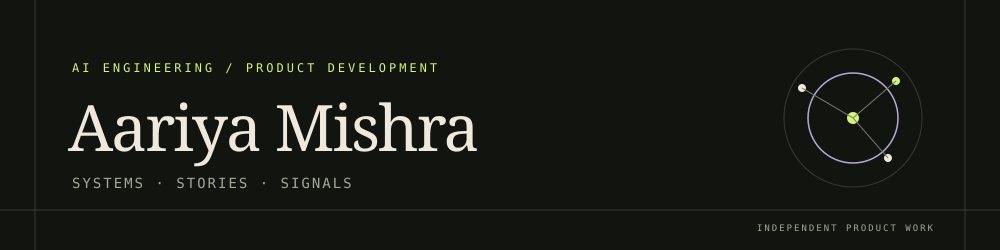

  

  <strong>AI engineer · product developer</strong> 
  I build AI systems, useful products, and experiments at the intersection of engineering and human ideas.

  <a href="https://www.linkedin.com/in/aariya-mishra/">LinkedIn ↗</a>
  &nbsp;·&nbsp;
  <a href="https://github.com/Aariya6">GitHub ↗</a>

<code>systems with sources</code> &nbsp; <code>products with agency</code> &nbsp; <code>ideas with room to breathe</code>

  
<strong>Navigate this profile</strong>

  <ol>
    <li><a href="#about">About</a></li>
    <li><a href="#selected-projects">Selected projects</a></li>
    <li><a href="#tech-stack">Tech stack</a></li>
    <li><a href="#experience">Experience</a></li>
    <li><a href="#research--interests">Research &amp; interests</a></li>
    <li><a href="#connect">Connect</a></li>
  </ol>

  
<strong>About</strong> · Building tools that keep their human context

  

  I work across applied AI and product engineering: from evidence-aware systems and data workflows to browser-based creative tools. I care about how software earns trust, makes its limits legible, and gives people more room to think and make.

  My projects tend to begin with a question bigger than the interface: How should a model show its sources? What does useful automation leave in a person's hands? Can a creative tool make complexity feel inviting?

  
<strong>Selected projects</strong> · A research record, a job-search tool, a literary atlas, and a music studio

  

  | Project | What I built | Engineering focus |
  | --- | --- | --- |
  | [Remote Job Pilot](https://github.com/Aariya6/ApplyIfworks) | A local-first assistant for job discovery, factual application materials, and guarded browser-based workflows. | Evidence-based fit categories, deterministic fallbacks, and a human checkpoint before submission. |
  | [TraceIT](https://github.com/Aariya6/TraceIT) · [Live demo](https://traceit-web.onrender.com/) | An aquatic-health record joining field observations, research data, analysis, and follow-up. | Provenance-aware data flows; rule-based, statistical, and ML signals remain distinguishable. |
  | [MARGINALIA](https://github.com/Aariya6/Marganalia_OK) | A literary atlas connecting people, places, works, themes, and reading traces. | Source-aware exploration, graph and timeline views, and local text experiments that avoid presenting model output as fact. |
  | [LOOM](https://github.com/Aariya6/Loom) | A browser-based music workspace for composing, arranging, and editing musical ideas. | Editable project data and hands-on sequencing, rather than a hosted generative-music API. |

  The project links above point to public repositories. TraceIT is the only featured project with a verified live demo at the time this profile was prepared.

  
<strong>Tech stack</strong> · Technologies used in the featured public projects

  

  These are tools present in the projects above, not a claim that repository language statistics measure proficiency.

  - **Languages &amp; web:** Python, JavaScript, HTML, CSS
  - **AI / ML:** PyTorch, scikit-learn; TF-IDF and PCA-based text experiments
  - **Backend:** FastAPI, SQLAlchemy
  - **Data:** SQLite, PostgreSQL
  - **Infrastructure &amp; workflow:** Docker, GitHub Actions

  
<strong>Experience</strong> · Product thinking through independent builds

  

  My public work shows independent product development across AI-assisted workflows, environmental data, digital humanities, and creative software. The through-line is turning a complex system into something people can inspect and use without hiding uncertainty or taking away meaningful control.

  I have not listed employers, dates, or credentials here because I could not verify them from the public profile information available during this review.

  
<strong>Research &amp; interests</strong> · Literature, evidence, agency, and creative technology

  

  I’m interested in the meeting point of literature and computation: how people find meaning across texts, how data keeps its provenance, and how technology can support interpretation without pretending to replace it. That curiosity also shapes my work on responsible automation, environmental records, and tools for making music.

  
<strong>Connect</strong> · Conversation and collaboration

  

  - [LinkedIn](https://www.linkedin.com/in/aariya-mishra/) — professional contact
  - [GitHub](https://github.com/Aariya6) — projects and experiments

  I have not added an email address because none was publicly provided.

<em>Build carefully. Stay curious. Leave room for the unexpected.</em>

